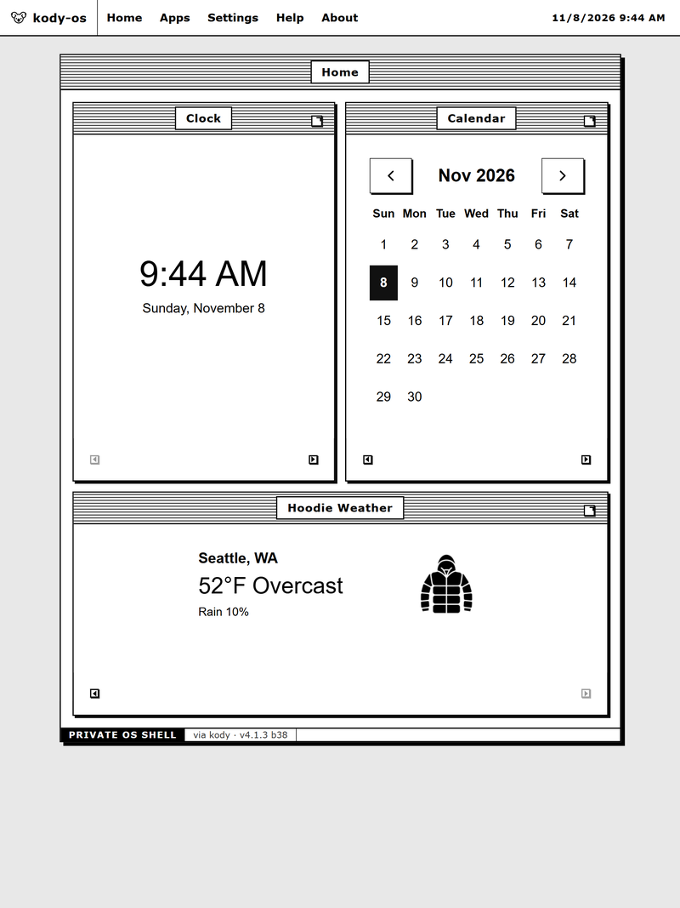
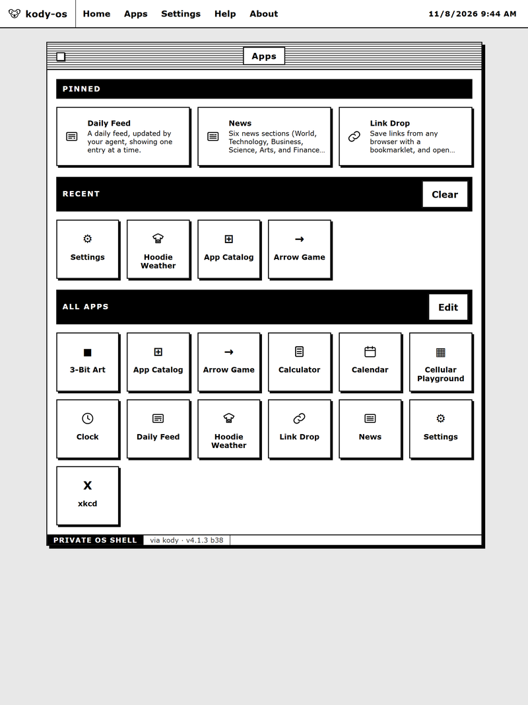
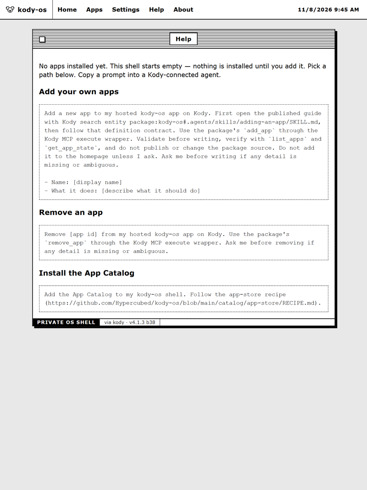
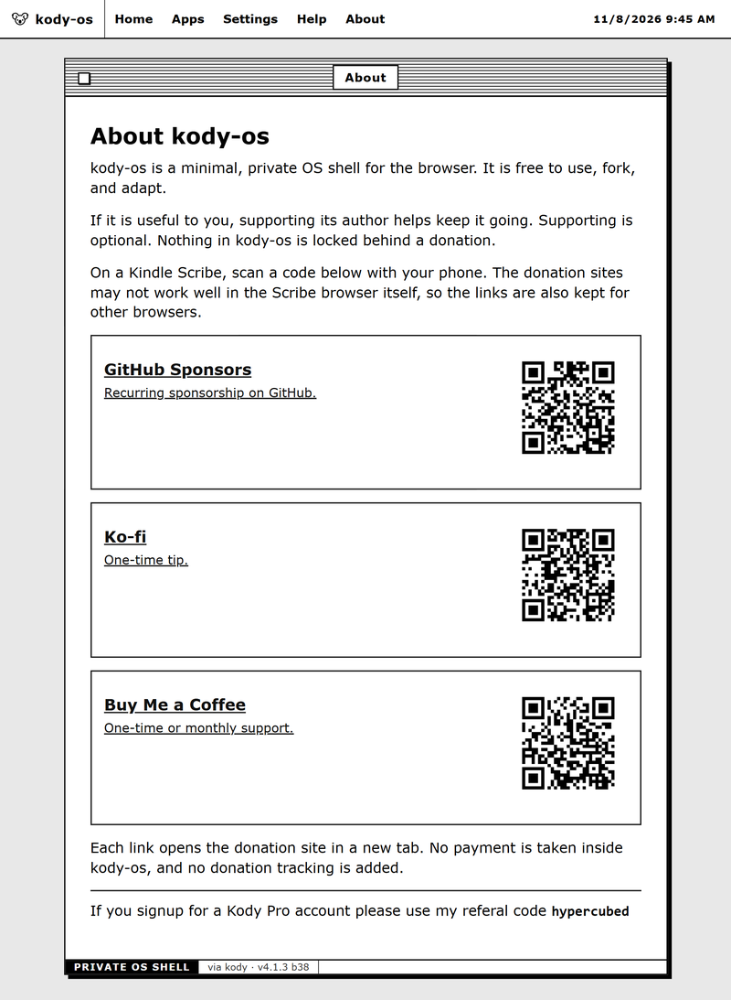

# kody-os

A personal AI OS that runs on [Kody](https://kody.codes/?ref=hypercubed) — a homepage for your devices, built with the Kindle Scribe in mind but working in most browsers. One generic shell renders every app; apps are JSON definitions stored in the package, not code you have to write. Ask a Kody-connected agent to add an app — a clock, a feed, a game — and it shows up on all your devices, with no republish needed.

Current package version: **v4.1.9** (build 44). See `pkg/package.json` for the authoritative version.






## Run it

You need a free [Kody](https://kody.codes/?ref=hypercubed) account, a fork of kody-os, and a publish. The full steps, with checks, are in the [Setup guide](pkg/docs/setup.md). The short version:

1. **Sign up for Kody (free).** Create your account with [this referral link](https://kody.codes/signup?ref=hypercubed).
2. **Fork kody-os.** Install it from [the kody-os listing on Kody](https://kody.codes/@hypercubed/kody-os) in one click — that forks it into your account and publishes it. Otherwise, fork this repository on GitHub and publish the package from `pkg/` through a repo session; your Kody-connected agent can do the publish.
3. **Sign in with Kody.** Open the app while signed in to your Kody account (including on the Kindle Scribe, which signs in to Kody like anywhere else). Access is granted and revoked in Kody itself: grant Use / `app:execute` on the app to let someone in; the shell performs no access check of its own.
4. **Install your first app.** A fresh install starts empty — no apps seeded, including no App Store. Install the App Store from the prompt on the empty Apps page (`install_from_catalog` with id `app-store` and the catalog base `https://raw.githubusercontent.com/Hypercubed/kody-os/main/catalog/`), or ask your agent to add an app (for example `counter`) with `add_app`. Adding an app never needs a republish.


## What it does

- **Home** — pinned widgets with live content, reorderable with corner arrows; honest empty state when nothing is pinned yet.
- **Apps** — every installed app as a tile; Edit mode pins, hides, and adds apps to the home dashboard.
- **App pages** — description, live state, and one plain-form button per declared action. Actions work with JavaScript disabled (GET form + redirect) and enhance in place where scripting runs. The App Store itself is the exception: it is a data app and requires JavaScript.
- **Feeds and proxy** — apps declare allowlisted HTTPS upstreams (`capabilities.feeds`, `capabilities.proxy`) read through the shell's same-origin feed/proxy routes with storage caching. No auth is forwarded upstream.
- **Access** — who can open the app is decided by Kody's permission system, not by the shell: grant Use / `app:execute` on the app to let someone in, revoke the grant (or sign out of Kody) to end their access. Package visibility and `internet_visible` are independent toggles — warning: turning `internet_visible` on exposes the app to anyone on the internet, with no shell gate left. Local `kody dev --target mock` needs no credential because there is no gate at all. Agents use MCP exports, which are governed by Kody's `package:execute` / org access. There is no secret to configure.
- **Help and About** — built-in shell pages, not apps. They can be hidden from the Settings app.

The shipped catalog has 18 apps: app-store, arrow-game, calculator, calendar, cellular-playground, clock, counter, daily-feed, eight-ball, generic-feed, hoodie-weather, link-drop, mac-puzzle, news, probe, settings, three-bit-art, and xkcd. See [`catalog/README.md`](catalog/README.md) for what each one does and the catalog membership checklist.

## For maintainers — two roots

This repository has two different "roots", and they serve different audiences. Do not confuse them:

- **This file, and `AGENTS.md` at the repository root, are for maintainers of this repository.** They describe the repo layout, how to change the shell, how to run the tests, how to write a spec, and how to publish.
- **`pkg/` is the Kody package itself.** Its `pkg/README.md` and `pkg/AGENTS.md` are for users and agents *of the package* on Kody: how to set up a fork, sign in, install apps, and write an app definition. Those files ship inside the package. The files at the repository root do not.

If you just want to use kody-os, start with the [Setup guide](pkg/docs/setup.md). The rest of this file is for people working on the code.

## Repository layout

```
pkg/                 The Kody package — the only directory that ships to Kody.
  src/                     Shell source: app.ts (fetch handler), feeds.ts,
                     client/, bridge/, and apps/ (registry, catalog, forms, client).
  docs/              Package-user docs: setup,
                     scribe-limitations, style-guide.
  scripts/           kody dev helpers: registry, catalog, add-app.
  public/            Theme, favicon, screenshots, and styles.css (inlined into src/shell-css.ts).
  package.json       Single source of truth for version and build.
  README.md          Package-user README (ships with the package).
  AGENTS.md          Package-user agent guide (ships with the package).
  .agents/skills/    Agent skills shipped with the package (adding-an-app).
catalog/             Shipped app dirs (definition.json + RECIPE.md + index.html),
                     generated index, plus tests.
openspec/            Specs and change proposals (see "Working with specs" below).
  specs/             Canonical, current specs (shell, app-registry, authoring, …).
  changes/           Active change proposals: proposal.md, design.md, tasks.md, spec deltas.
  changes/archive/   Closed changes, dated by close-out (e.g. 2026-11-07-…).                     tests/               Repository-level harnesses (bun): catalog, store, agent-tools,
                     open-mode, home-widget-counter, isolation-demo, …
docs/                Repository-level docs: the 2026-10-27 security review.
.agents/skills/      Repository tooling skills (none at the moment).
.claude/             Claude Code settings for this repo.
```

## Developing

All shell work happens in `pkg/`. The repository root has no build step of its own.

### Run the shell locally

Preferred local-dev command (catalog + `kody dev`, LAN only when asked):

```sh
./scripts/dev-local-catalog.sh          # catalog + kody dev, no LAN
./scripts/dev-local-catalog.sh --lan    # catalog + kody dev on 0.0.0.0:4302
./scripts/dev-local-catalog.sh stop     # stop both
```

LAN is opt-in and trusted-LAN only: `--lan` runs `kody dev --host 0.0.0.0`
directly, exposing the whole dev server on port 4302 in plain HTTP with no
TLS. Never start `--lan` on public Wi-Fi or beyond the local network.

Bare form (no local catalog, no LAN):

```sh
cd pkg
export NO_PROXY='*' no_proxy='*'
unset HTTP_PROXY HTTPS_PROXY http_proxy https_proxy ALL_PROXY
kody dev --target mock
# → App ready at http://127.0.0.1:4302/
```

Full local-dev instructions, including installing the App Store, are in `pkg/README.md` and `pkg/AGENTS.md`. Two rules that bite every new maintainer, so they are stated here too:

- **Run `kody dev` from `pkg/` only.** The repository root fails (missing `kody.app.entry`).
- **Stop the preview before any mock-store write.** A running preview serves its startup snapshot from memory; a `kody execute` write made while it runs lands on disk and is then silently overwritten by the preview's next action. Stop, write, restart.

Two device gotchas when opening the preview from a phone, tablet, or Kindle:

- **Missing images on a Kindle is usually the browser setting, not the app.**
  Kindle browser: three-dot menu → Browser Settings → **Disable Images**. When
  on, every `` fails, including ordinary HTTP PNGs and `data:` URIs,
  while inline SVG still renders. The hosted app fails the same way, which is
  the tell.
- **Device times out while the host works: Wi-Fi client isolation.** Guest/IoT
  SSIDs (or a host firewall on the port) block device-to-host traffic. Put both
  on the same SSID, or open the port.

### Run the tests

```sh
bun tests/catalog-harness.ts
bun tests/store-harness.ts
bun catalog/tests/app-store-tests.cjs
```

Run the harness for the area you changed, plus the catalog harness whenever a catalog definition changes. A harness failure is a real signal unless you have verified it is pre-existing on a clean checkout — say so explicitly in that case instead of waving it through.

## Working with specs

Changes to the shell go through OpenSpec, not straight to code:

1. Create a change under `openspec/changes/<slug>/` with `proposal.md`, `design.md`, and `tasks.md`, plus a spec delta under `specs/<spec>/spec.md` for each canonical spec it changes.
2. Implement against the tasks, keeping the canonical specs in `openspec/specs/` in sync in the same change.
3. When the change is done, archive it under `openspec/changes/archive/<YYYY-MM-DD>-<slug>/` with a close-out note in its `tasks.md`. Do not mark a verification step done if it was not run — record what was substituted for it instead (for example, a harness run in place of a `kody dev` check, with the reason).

Active changes and their status live in `openspec/changes/`; the archived history is the record of what actually shipped and when.

## Rules that shape every change

The full maintainer rules are in [`AGENTS.md`](AGENTS.md). The ones that most often decide a review:

- **ES2019 only** for shell and bundle code (Kindle Scribe / Chromium 80 ceiling), system fonts only, zero emojis, 48px minimum tap targets, no flexbox gap (grid gap is fine).
- **GET forms only in browser UI.** Kody's edge rejects mutating requests from package-app subdomains with a foreign or `null` Origin, so never render a POST form or `fetch` a POST. `POST /apps/:id` stays for API clients only.
- **Version + build are a single source of truth in `pkg/package.json`.** `pkg/AGENTS.md` and `pkg/README.md` headers must match it, updated in the same commit as any bump. Changes outside `pkg/` (specs, repo tooling) do not bump the version; app definitions written via `add_app` are data, not package code, and do not either.
- **Styles are inlined.** `pkg/src/shell-css.ts` is generated from `pkg/public/styles.css` — regenerate after any theme edit.
- **Capabilities are disclosure, not a sandbox.** Bundle scripts run same-origin with the visitor's full authority, so installing an app is trusting its code. Review third-party bundles before shipping one in the catalog.

## Publishing

Git and Kody publishing are separate steps, and neither implies the other:

- **Git:** this repository lives on GitHub. Pushing to GitHub does not publish anything to Kody, and publishing to Kody does not push anything to Git.
- **Kody:** publishing the package from `pkg/` increments `build` by exactly 1, even when `version` is unchanged. Never reset or skip a build number, and never reuse a `version` + `build` pair.
- **Before any commit, push, or publish, name the exact scope and wait for direction.** A publish in particular is never implied by "the code is ready".

Never push with `--mirror` or `--all` — that is how unrelated refs get copied into a public repo.

## License

kody-os is licensed under the MIT License. See [`LICENSE`](LICENSE) at the repository root. An identical copy ships inside the package at `pkg/LICENSE`.
