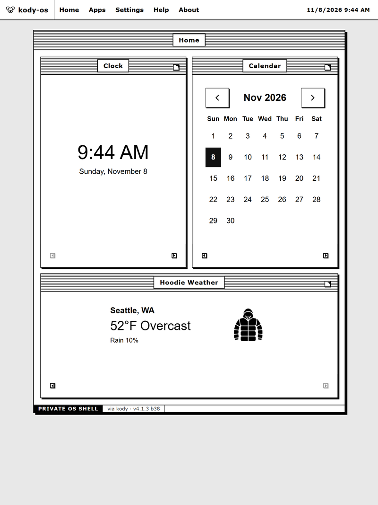
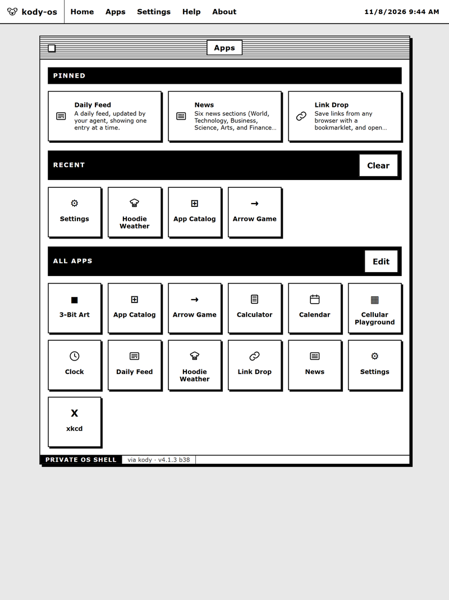
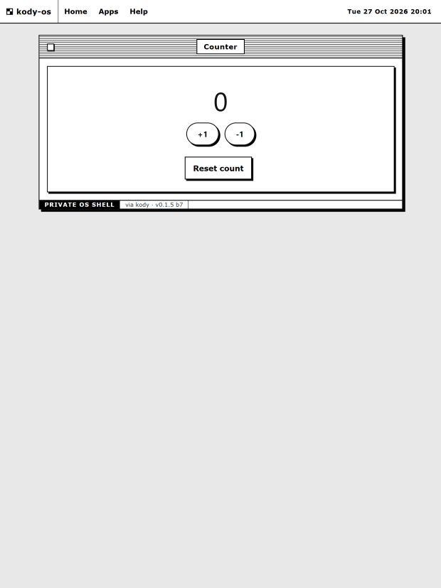
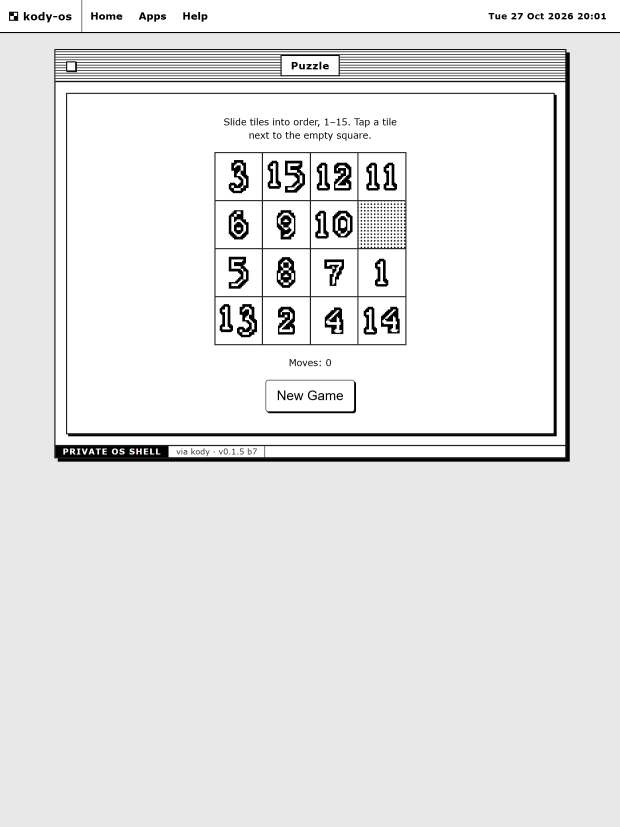

# Kody OS

Minimal OS shell shared by humans and agents. Apps are JSON definitions in package storage — rendered by one generic shell, acted on through one shared handler, identically via the human UI and via MCP. Browser-first, high-contrast, e-ink-friendly. Kindle Scribe compatibility is a hard constraint: ES2019 only, no external stylesheets, no emojis.

Current: **v2.3.0** — Apps Edit mode, a data-only App Store through a management API, bundle capabilities (`manageApps`, `proxy`), always-visible Manage apps link in the All apps header, alphabetical Apps launcher, catalog-sourced store descriptions, data-driven apps, homepage widgets, server-side feed proxy, hardened response headers, bridge adapter (`window.KodyBridge` v1), JSON state seed, schemaVersion 5, home widget sections carry `data-app-id`, modal panels open at 25vh with an open-full-page box, default open mode (`ui.openAs`), agent catalog/pin/home/hide tools, owner-only Kody login bypass, the official Kody mark as favicon and default header mark, and a page-mode expand control that fills the browser window edge-to-edge, with single-frame app pages and a full-viewport white fullscreen view, and an OTP-only device gate (legacy access key removed).

## Screenshots

Files live in `public/screenshots/` (served at `<app>/_assets/screenshots/`).






## What it does

- **Home** — pinned widgets with live content, reorderable with corner arrows; honest empty state when nothing is pinned yet.
- **Apps** — every installed app as a tile; Edit mode pins, hides, and adds apps to the home dashboard.
- **App pages** — description, live state, and one plain-form button per declared action. Actions work with JavaScript disabled (GET form + redirect) and enhance in place where scripting runs.
- **Feeds** — apps can declare allowlisted HTTPS upstream feeds (`capabilities.feeds`) read through `GET /feed/:app/:name`, and generic allowlisted upstreams (`capabilities.proxy`) read through `GET /proxy/:app/:name`, same-origin with storage caching. No auth is forwarded upstream; errors never echo the URL.
- **Access** — the browser shell is locked by one-time codes so e-ink devices open it without Kody login. Each code is 4 digits, single use, valid 10 minutes; entering it burns the code and mints a 30-day session cookie with clean, code-free URLs. There is no other way in besides owner Kody login, and no secret to configure. Agents use MCP exports, which are never gated. Full steps: [Device key](docs/device-key.md).

## Setup

Setting up a fork of kody-os (fork, publish, unlock, first app) is covered start to finish in the [Setup guide](docs/setup.md). Start there; the sections below assume the OS is already set up.

## How to know it is working

- Home shows live widgets for pinned apps, or the honest **no widgets yet** empty state pointing at Apps Edit's **Add to home** control.
- Apps lists installed apps as tiles, or the honest **no apps yet** empty state.
- An app page shows its description, live state fields, and one form button per declared action.
- Submitting an action works without JavaScript and returns to the app page showing the new state.

## Adding an app

An app is a JSON definition in package storage, not code. An agent calls MCP `add_app` and the app appears on the Apps page with no republish. The same definition works in the hosted OS and the local `kody dev` preview; the two stores are separate, so add it to each target.

See [Adding an app](docs/adding-an-app.md) for the definition contract, both paths, verification, homepage placement, export, and removal. See [Scribe limitations](docs/scribe-limitations.md) for the binding Kindle Scribe constraints.

### Recommended prompt

Copy this to your Kody-connected agent and fill in the bracketed parts:

> Add a new app to my hosted kody-os app on Kody. First open the published guide with Kody search entity `package:kody-os#docs/adding-an-app.md` and the Scribe constraints at `package:kody-os#docs/scribe-limitations.md`, then follow that definition contract. Use the package's `add_app` through the Kody MCP `execute` wrapper. Validate before writing, verify with `list_apps` and `get_app_state`, and do not publish or change the package source. Do not add it to the homepage unless I ask. Ask me before writing if any detail is missing or ambiguous. When the need is a small toy with JS behavior (random shake, live clock), write a bundle (entry `index.html`, relative `.html`/`.js`/`.css` only, 256 KiB cap, vanilla ES2019, inlined, zero emojis); otherwise stay on the shared validated-state operators.
>
> - App id: [slug]
> - Name: [display name]
> - What it does: [one sentence]

## Local development (`kody dev`)

Run the real shell locally from `pkg/` with bundled build, persistent mock storage, and live-reload. Stop the server before any write below: a running preview keeps its mock state in memory and rewrites the store from that snapshot on its next action, so a write made while it is running shows up nowhere and is then silently overwritten.

```sh
cd pkg
# proxy bypass required on this host
export NO_PROXY='*' no_proxy='*'
unset HTTP_PROXY HTTPS_PROXY http_proxy https_proxy ALL_PROXY
```

Mint a local-dev OTP and install the `app-store` catalog app (one-time per fresh mock store). Install it explicitly: the shell's automatic first-run seed only fires on an empty registry, so adding any other app first silently skips the App Store. No Python step is needed any more: `scripts/catalog.ts` installs straight from the shipped catalog by id, and re-installing preserves state. Mint while the server is stopped, then start it promptly: the code is single use, valid 10 minutes, and burns into a 30-day session cookie.

```sh
kody execute --target mock --file scripts/mint-dev-otp.ts
# → { "ok": true, "code": "4821" } — example only; use the code you actually get
kody execute --target mock --file scripts/catalog.ts --params '{"op":"install","id":"app-store"}'
```

To install your own definition file instead of (or in addition to) a catalog app, use `scripts/add-app.ts` — its params *are* the definition, with no op wrapper (that wrapper belongs to `scripts/registry.ts`):

```sh
kody execute --target mock --file scripts/add-app.ts --params "$(cat myapp.json)"
```

Then start the server:

```sh
kody dev --target mock
# → App ready at http://127.0.0.1:4302/
```

Open `http://127.0.0.1:4302/` (VSCode port-forward 4302 to reach it remotely) and enter the minted code in the unlock form. The footer reads `via cookie` with a clean URL; the Apps page lists the **App Store**. A later restart with the mock store intact does not need a fresh code — only a store reset or a lost cookie does. A minted OTP is single use, so there is no repeatable authenticated fetch check: verify actions in the unlocked browser instead.

Useful checks: `kody dev check --target mock --offline`, `curl http://127.0.0.1:4302/__kody/dev/status`. Persistent server across sessions: `systemctl --user enable --now kody-os-dev.service`. No `job`/`webhook`/`emit` handlers are declared, so those subcommands correctly report `(none)`. To clear local sessions and OTPs: `kody execute --target mock --file scripts/clear-auth.ts` (returns counts only).

## Theme file

Forks rebrand by editing `os-theme.json` (all fields optional): `name` (header brand + title suffix), `title` (document-title prefix override), `icon` (short glyph or a sanitized inline SVG; empty keeps the default Kody mark), `background` (`desk`, `paper`, or a custom 8×8 grid object `{ "grid": [r0..r7] }` of eight 0-255 row bytes, MSB left, drawn black on paper as a repeating tile). Invalid grids or SVG fall back to the stock look, as do a missing file, missing field, or broken JSON.

Every shell page also links `public/favicon.png` (the official Kody mark, served at `<app>/_assets/favicon.png`) as its favicon, and the same file is the default upper-left header mark when `os-theme.json` sets no `icon`.


